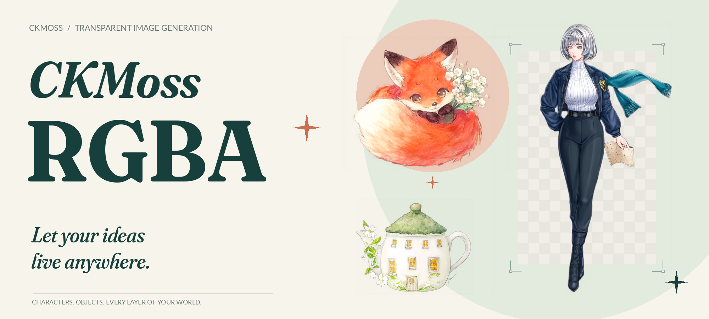

<p align="center"></p>

<p align="center"><b>让角色、插画和小物件，自由进入你的画面。</b></p>
<p align="center">中文 · <a href="README.en.md">English</a> · <a href="https://huggingface.co/ChenkinLab/CKMoss-Image-RGBA">模型下载</a> · <a href="https://github.com/Chenkin-x/ComfyUI-CKMoss-Image-RGBA">ComfyUI 节点</a></p>
<p align="center">作者：<a href="https://github.com/chinoll">chinoll</a></p>

CKMoss Image RGBA 提供一个 **RGBA VAE** 和一个**可选的 DiT LoRA**，让 MOSS-Image 输出带 Alpha 通道的图片，用于角色素材、插画拼贴与图层合成。

**不用 DiT LoRA 也能生成图片。** 保留原版 MOSS-Image，替换为本项目的 RGBA VAE 即可；配套 LoRA 用于适配透明图像生成。两种方式的透明效果并不保证相同。

本仓库整理模型代码。想直接出图，请使用独立的 [ComfyUI 节点仓库](https://github.com/Chenkin-x/ComfyUI-CKMoss-Image-RGBA)，其中包含中文、英文教程，以及两种可拖入 ComfyUI 的工作流。

## 选择你的用法

| 组合 | 需要的文件 |
| --- | --- |
| 原版 MOSS-Image + RGBA VAE | `vae/moss_rgba_vae.safetensors` |
| MOSS-Image-SFT + RGBA VAE + DiT LoRA | 上述 VAE，以及 `loras/moss_rgba_dit_lora.safetensors` |

两份权重都在 [ChenkinLab/CKMoss-Image-RGBA](https://huggingface.co/ChenkinLab/CKMoss-Image-RGBA/tree/main)。VAE 已经合并，可直接使用；LoRA 需要配合基础模型。基础模型和文本编码器需另行准备。

## 效果展示

以下为 RGBA VAE + DiT LoRA 新生成的实际输出，保留原始 Alpha，仅为展示添加底色和排版。


原始 PNG、提示词和随机种子见 [assets/samples](assets/samples)。

## Python 生成

在已有依赖的环境中，从仓库根目录运行，无需安装本项目。`--base` 指向完整的官方 MOSS-Image-SFT 本地快照。

```bash
python generate.py \
  --base models/MOSS-Image-SFT \
  --vae models/moss_rgba_vae.safetensors \
  --prompt "A small fox holding a white flower, watercolor illustration, transparent background." \
  --output fox.png
```

上面的命令**不加载 DiT LoRA**。需要使用时，添加：

```bash
  --lora models/moss_rgba_dit_lora.safetensors
```

## 代码导航

| 入口 | 职责 |
| --- | --- |
| `generate.py` | 生成 RGBA PNG，LoRA 可选 |
| `moss_rgba/` | 模型、VAE、LoRA、数据与目标函数 |
| `train_vae.py` / `train_dit.py` | 分别处理 VAE 和 DiT 的适配 |
| `prepare.py` | 文本与 latent 缓存 |
| `tools/export_weights.py` | 导出独立推理权重 |
| `tools/render_showcase.py` | 用实际 PNG 重建 Banner 与海报 |

开发入口与配置见 [使用代码](docs/code.md)。

## 致谢与许可

基于 [MOSS-Image](https://github.com/OpenMOSS/MOSS-Image) 与 [FLUX.2 VAE](https://github.com/black-forest-labs/flux2#flux2-autoencoder)。感谢 [niangao2331](https://github.com/niangao2331) 的数据支持。

本项目采用 [GPLv3](LICENSE)。第三方来源及许可见 [NOTICE](NOTICE)。
